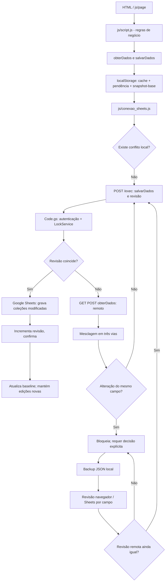

# Controle Financeiro — mapa de sincronização e triagem

Fonte: branch `main` pública de `yurink04/Controle-Financeiro`, confrontada com o pacote da última revisão, em 23/10/2026.

## Diagrama

## Falha observada

Console: `Sincronização bloqueada: campos: Array(1)`, seguido de `Foram encontrados 1 conflitos entre o navegador e o Sheets`. Isso **não** demonstra que a conexão com a API esteja indisponível; o bloqueio ocorre quando a mesma propriedade diverge dos dois lados em relação ao snapshot-base. Os avisos de Tracking Prevention para `cdn.jsdelivr.net` (Chart.js) e a mensagem de ViewTransition não são evidências do problema de escrita no Sheets.

## Alterações neste pacote

- Mesclagem aceita escolhas **explícitas** por caminho; sem escolha permanece bloqueada.
- A tela de recuperação mostra divergências e exige confirmação após backup.
- Antes do envio reconciliado, verifica novamente a revisão do servidor; falha sem sobrescrever quando mudou.
- Após confirmação do POST, lê novamente o armazenamento para não regravar uma versão mais antiga por cima de outra aba.
- Em conflito automático, mantém o snapshot local mais recente identificado após o `await` da busca remota.
- Não modifica o formato das coleções nem o contrato de `Code.gs`.
- Remove `@view-transition { navigation: auto; }` do CSS para evitar a exceção de navegação observada em alguns navegadores (independente de sync).

## Limitações e cuidados

- A divergência exata do navegador do usuário não pôde ser inspecionada, pois `localStorage` pertence ao computador dele; pode ser um campo financeiro que precisa de decisão consciente.
- Conciliações destrutivas (ex.: exclusão em um dispositivo e edição no outro) necessitam escolha explícita; nunca se presume vencedor.
- A confirmação da revisão elimina muitas corridas, mas alterações realmente concorrentes continuam sujeitas a rejeição pelo Apps Script e novo ciclo de conciliação, como desejado.
- O repositório público contém a chave compartilhada do frontend. Ela é pública por natureza; a autenticação de usuários **deve** continuar a ser validada pelo servidor. Planejar rotação da chave de integração se usada como segredo.
- Testes `node js/cjs/executar-testes.cjs` são offline; acesso ao Google Sheets real e varredura visual integral não foram executados.
